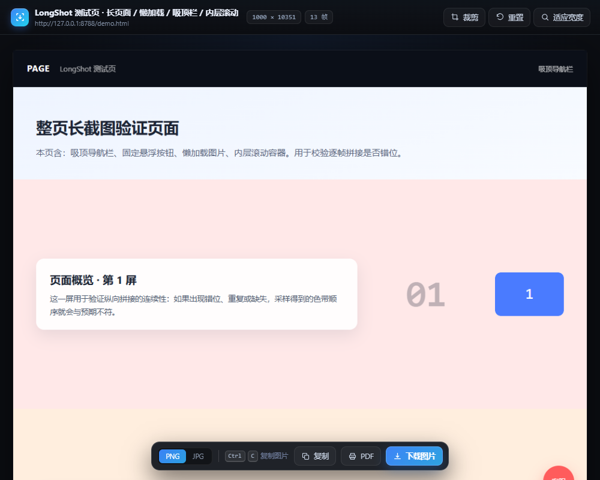
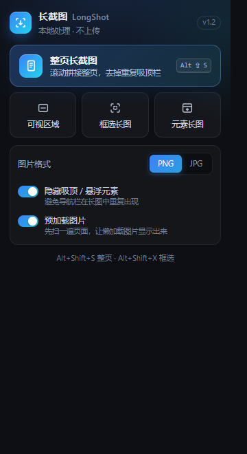
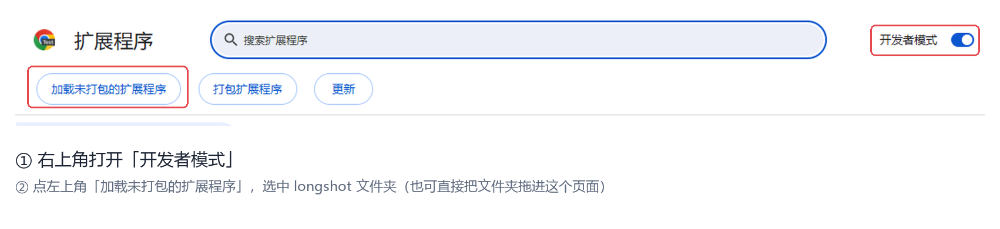

# 长截图 LongShot

**一键把整个网页截成一张长图**的浏览器扩展。滚到哪儿截到哪儿、逐帧无缝拼接，支持整页 / 框选 / 元素三种长图模式，可导出 PNG、JPG、复制到剪贴板或打印成 PDF。

零依赖、零联网、无第三方库；所有截图与合成都在本地完成。



---

## 特性

| 模式 | 说明 | 适用场景 |
| --- | --- | --- |
| **整页长截图** | 自动滚动页面并逐帧拼接，输出完整页面 | 文章、商品详情、订单页、报告 |
| **框选长图** | 拖拽框选任意矩形；**拖到屏幕上下边缘会自动滚动**，选区能一直延伸出屏幕 | 只要页面某一列内容，如正文栏、侧栏 |
| **元素长图** | 点选一个可滚动容器，只把它的内容拼成一张长图 | 聊天记录、文档目录、表格面板、内层滚动页 |
| **可视区域** | 只截当前屏幕可见部分 | 快速留存 |

细节处理：

- 吸顶导航 / 悬浮客服只在第一帧保留，**长图里不会每屏重复**
- 隐藏滚动条、临时关闭平滑滚动，避免残影与「没滚到位就拍」
- 按 `图片物理宽度 / 视口宽度` 反算缩放比，**2K / 4K / 125% 缩放都能对齐**
- 懒加载图片会先预扫一遍，页面中途变长会动态补帧
- 成图超过 4600 万像素自动等比降采样，避免浏览器 OOM 白屏

## 预览页

截图完成后自动打开预览页，可以裁剪、缩放、切换格式、复制、下载、打印。

- **Ctrl / ⌘ + C** 复制整张图到系统剪贴板，可直接粘进微信 / 飞书 / Word
- **Ctrl / ⌘ + S** 保存到下载目录
- **裁剪**：拖拽框选要保留的部分，「重置」恢复完整画面
- **打印 / PDF**：调起系统打印，目标选「另存为 PDF」



## 安装

### 方式一：一键脚本（Windows）

1. 解压发布包（不要在压缩包里直接双击）。
2. 双击 `安装-Windows.cmd`：它会把扩展复制到 `%LOCALAPPDATA%\LongShot\extension`，并自动打开浏览器的扩展管理页。
3. 按图示做两步：



装好后点工具栏的拼图图标，把「长截图 LongShot」固定出来。

> 若弹出「Windows 已保护你的电脑」，点「更多信息」→「仍要运行」。脚本只做两件事：复制文件、打开浏览器。

### 方式二：手动加载（任意系统）

1. 打开扩展管理页：Chrome `chrome://extensions`、Edge `edge://extensions`，360 / QQ 浏览器在「扩展管理」里。
2. 打开右上角「开发者模式」。
3. 点「加载未打包的扩展程序」，选中 `longshot` 文件夹（也可以直接把文件夹拖进该页面）。

### Firefox

`about:debugging#/runtime/this-firefox` → 「临时载入附加组件」→ 选 `longshot/manifest.json`。

> 临时加载在浏览器重启后失效，正式安装需要签名。也可以先用 `python tools/build.py` 生成 `dist/LongShot-*-firefox.zip`。

### 从源码

```bash
git clone https://github.com/cola-bang/longshot-screenshot.git
cd longshot-screenshot
python tools/restore-assets.py     # 可选：若图标等文件只有 .b64 后缀，用它还原
python tools/build.py              # 可选：打包 zip
```

## 使用

1. 打开要截的网页，等页面加载完成。
2. 点工具栏图标选模式（或按 `Alt + Shift + S` / `Alt + Shift + X`）。
3. 页面开始滚动，图标上显示进度（如 `3/13`）。**此时不要切换标签页**，否则会中断。
4. 完成后在预览页裁剪 / 复制 / 下载。

> 首次使用必须点一次扩展图标：扩展只申请了 `activeTab` 权限（不读取浏览历史、不常驻访问网站），点击图标才会临时授权当前页面。

## 工作原理

```
popup ──► background ──► content script（编排）
                            │  逐帧请求
                            ▼
                     chrome.tabs.captureVisibleTab
                            │
                            ▼
                  帧数据写入 storage.local
                            │
                            ▼
                viewer 页按记录的偏移合成画布
```

1. **偏移量取自真实滚动位置**，而不是假设「每次滚一屏」；页面滚动被限制或出现滚动锚定也不会错位。
2. **吸顶元素从第 2 帧起临时隐藏**，截图结束立即还原。
3. **编排放在 content script**（页面生命周期稳定），background 只负责短操作，避免 Service Worker 被回收打断长任务。
4. **合成放在独立预览页**，不占用原页面内存；大图也更容易被回收。

## 已知限制

| 限制 | 说明 |
| --- | --- |
| `chrome://`、`edge://`、扩展商店 | 浏览器禁止注入脚本，无法截图 |
| PDF 内置阅读器 | 同上，请改用系统截屏 |
| 单张最长 20000 px | 超出部分会截断并提示；建议先缩小页面缩放 |
| 页面需在前台 | 切走标签页会中断（浏览器限制） |
| 内层滚动容器高于视口 | 元素模式要求容器完整可见 |
| 动画 / 视频 | 滚动截图存在时间差，播放中的内容可能出现帧差 |
| 截图速度 | `captureVisibleTab` 限制每秒 2 次，约 0.7 s/帧 |

## 开发

```bash
python tools/restore-assets.py    # 从 *.b64 还原图标与截图（首次必须）
python tools/make_icons.py        # 重新生成图标（需要 Pillow）
python tools/build.py             # 打包 dist/LongShot-v{ver}-{chromium,firefox}.zip
cd test && npm i && node run.mjs   # 端到端测试（Playwright + 本地 Chromium）
```

测试覆盖：整页拼接（24 个色带采样校验 + 高度校验）、框选长图（拖到边缘自动滚动）、元素长图、区域、可视区域、`Ctrl+C` 写剪贴板、弹出面板渲染。

```
├── longshot/            扩展本体（加载这个目录）
│   ├── manifest.json    Manifest V3
│   ├── background.js    注入脚本、逐帧截屏、开预览页
│   ├── content.js       滚动编排、浮层隐藏、区域/元素拾取
│   ├── popup.*          工具栏面板
│   ├── viewer.*         预览页：合成、裁剪、导出
│   └── icons/           PNG 图标（由 *.b64 还原）
├── tools/               图标生成、安装图示、打包、资源还原
├── test/                演示页与 Playwright 端到端测试
└── docs/                README 截图
```

## 更新日志

**1.2.0**
- 预览页支持 `Ctrl / ⌘ + C` 直接复制图片，`Ctrl / ⌘ + S` 保存
- 预览页 UI 重做：顶部信息条 + 悬浮工具栏，操作状态与结果都有明确反馈
- 弹出面板层级与对比度调整，版本号改为自动读取

**1.1.0**
- 框选长图：拖到屏幕上下边缘自动滚动，选区可跨屏延伸
- 一键安装助手与安装图示
- 修复 PNG 模式下仍显示 JPG 质量条

**1.0.0**
- 首发：整页 / 可视区域 / 区域 / 元素四种模式

## License

[MIT](LICENSE)
